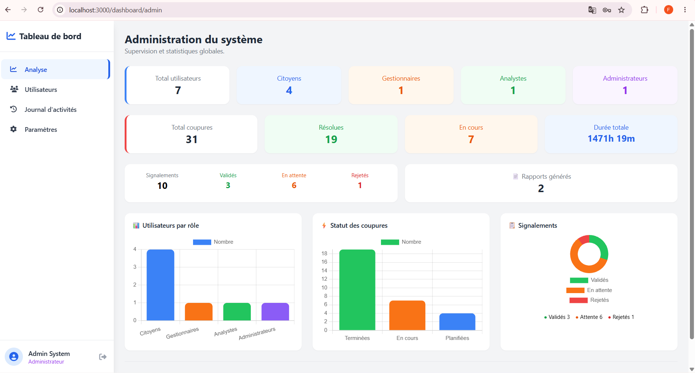
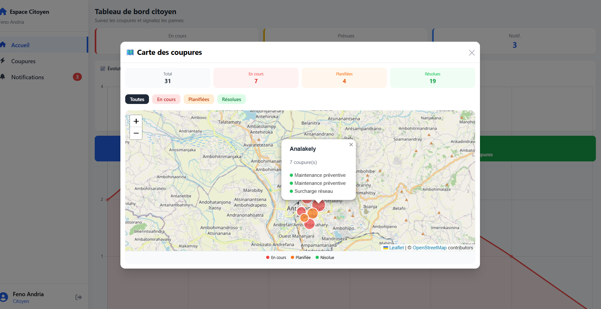
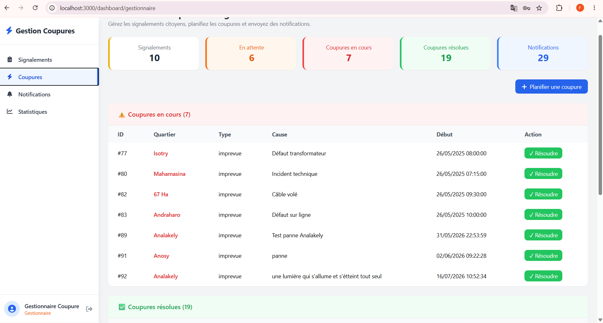
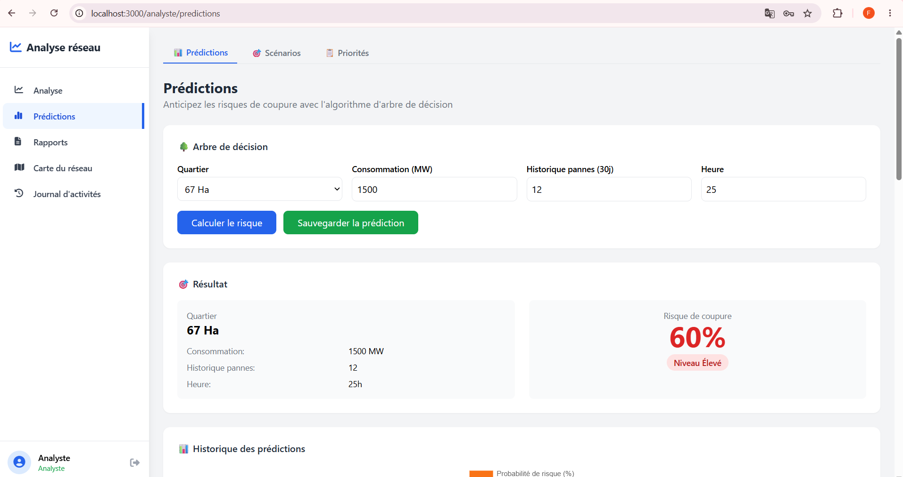
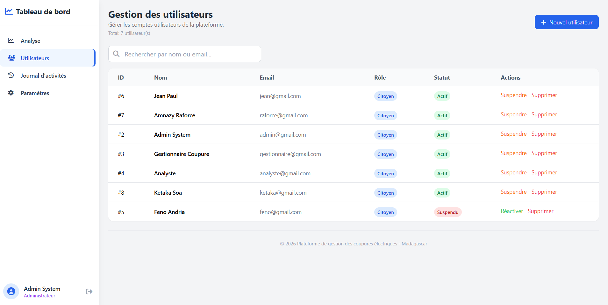
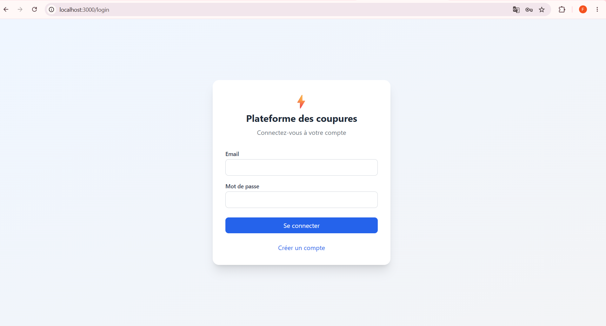

# Electricity Outage Management

### Plateforme de gestion et de prédiction des coupures d'électricité à Madagascar

Application web Full-Stack dédiée au signalement, au suivi, à l'analyse et à la prédiction des coupures d'électricité.

Ce projet vise à faciliter la communication entre les citoyens et les gestionnaires du réseau électrique, tout en proposant des outils d'analyse pour améliorer le suivi des interruptions de service.

## Objectifs

- Centraliser les informations concernant les coupures d'électricité.
- Permettre aux citoyens de signaler des interruptions de service.
- Faciliter le suivi et la gestion des coupures.
- Visualiser les informations géographiques sur une carte interactive.
- Analyser les données historiques.
- Proposer des fonctionnalités de prédiction des risques de coupure.

## Fonctionnalités principales

### Citoyen
- Création et gestion de compte.
- Signalement des coupures d'électricité.
- Consultation des coupures et de leur état.
- Consultation des notifications.

### Gestionnaire
- Gestion et suivi des coupures.
- Consultation et traitement des signalements.
- Envoi de notifications.
- Consultation des statistiques opérationnelles.

### Analyste
- Analyse des données de coupures.
- Consultation des statistiques et graphiques.
- Visualisation géographique des incidents.
- Analyse prédictive des risques de coupure.

### Administrateur
- Gestion des utilisateurs.
- Consultation des journaux système.
- Supervision générale de la plateforme.

## Technologies utilisées

| Couche | Technologies |
|---|---|
| Frontend | React, JavaScript, Vite |
| Backend | Python, FastAPI |
| Base de données | PostgreSQL |
| API | REST |
| Conteneurisation | Docker, Docker Compose |
| Versionnement | Git, GitHub |

## Architecture du projet

```text
electricity-outage-management/
├── backend/
│   ├── app/
│   │   ├── algorithms/
│   │   ├── api/
│   │   ├── core/
│   │   ├── middlewares/
│   │   ├── models/
│   │   ├── repositories/
│   │   ├── schemas/
│   │   ├── services/
│   │   └── utils/
│   ├── migrations/
│   ├── Dockerfile
│   ├── docker-compose.yml
│   ├── requirements.txt
│   └── .env.example
├── frontend/
│   ├── public/
│   ├── src/
│   │   ├── components/
│   │   ├── contexts/
│   │   ├── hooks/
│   │   ├── pages/
│   │   └── utils/
│   └── package.json
├── scripts/
│   ├── init_db.sql
│   ├── link_roles.sql
│   ├── seed_static_sql.sql
│   └── seed_users.py
└── README.md
```

## Algorithmes

Le backend comprend des modules dédiés à l'analyse et à l'optimisation :

- Dijkstra : traitement de problèmes de chemins dans un graphe.
- Algorithmes gloutons : optimisation heuristique.
- Arbre de décision : analyse et classification.
- Modules de prédiction : estimation des risques de coupure.

## Captures d'écran

### Tableau de bord


### Carte interactive


### Gestion des coupures


### Analyse et prédiction


### Administration


### Authentification


## Installation

### Prérequis

- Python
- Node.js et npm
- PostgreSQL
- Git
- Docker et Docker Compose (facultatifs selon le mode de lancement)

### Cloner le projet

```bash
git clone https://github.com/fenofaf7/electricity-outage-management.git
cd electricity-outage-management
```

### Configuration du backend

```bash
cd backend
python -m venv .venv
```

Sous Windows :

```powershell
.\.venv\Scripts\Activate.ps1
pip install -r requirements.txt
```

Créer un fichier `.env` à partir de `.env.example`, puis configurer les variables nécessaires :

- `DATABASE_URL`
- `SECRET_KEY`
- `POSTGRES_PASSWORD`

La base PostgreSQL doit être initialisée conformément aux scripts SQL et aux modèles du projet.

### Démarrer le backend

Une fois PostgreSQL configuré et accessible :

```bash
uvicorn app.main:app --reload
```

Documentation interactive de l'API (si les routes de documentation FastAPI sont activées) :

http://localhost:8000/docs

### Démarrer le frontend

Depuis un second terminal :

```bash
cd frontend
npm install
npm run dev
```

Ouvrir l'adresse locale affichée par Vite, généralement :

http://localhost:5173

## Sécurité

Les fichiers `.env` contenant les informations sensibles ne sont pas publiés dans le dépôt.

Le fichier `.env.example` fournit un modèle de configuration sans identifiants réels.

Les comptes de démonstration doivent utiliser des identifiants distincts des comptes réels.

## Documentation

Le dépôt contient également des documents de conception et des diagrammes UML permettant de comprendre les besoins fonctionnels et l'architecture de l'application.

## État du projet

Projet académique de développement Full-Stack. Le dépôt présente le code source, les modules métier, les algorithmes et les documents de conception.

## Auteur

Développé dans le cadre d'un projet académique en informatique.

GitHub : [@fenofaf7](https://github.com/fenofaf7)